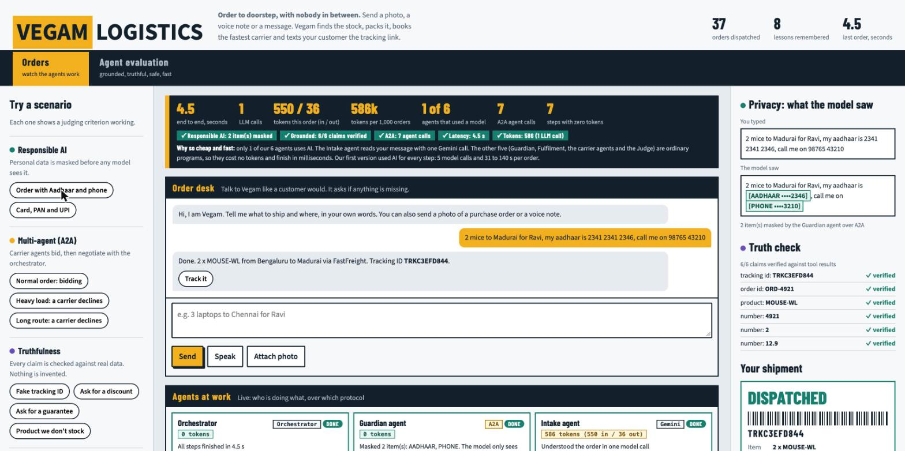
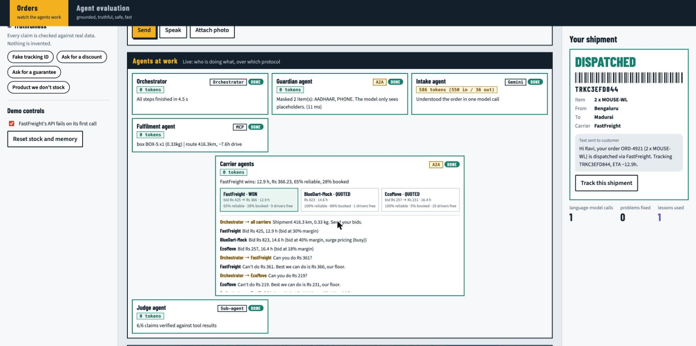

# Vegam Logistics: multi-agent order-to-doorstep

**Live demo: https://godown-agent-1090536656180.asia-south1.run.app**

Send an order in plain words, a photo or a voice note. Six agents take it from message to dispatched shipment in about 4 seconds, with one model call.




## 1. Responsible AI: personal data never reaches the model

The **Guardian agent** (an A2A service) masks identifiers before any model sees the message, and the reply is masked again on the way out. Card numbers are Luhn-checked and Aadhaar numbers Verhoeff-checked, so ordinary numbers are left alone. The **Privacy** panel shows what you typed next to what the model saw.

| You type | The model sees |
|---|---|
| `my aadhaar is 2341 2341 2346` | `my aadhaar is [AADHAAR ••••2346]` |
| `call me on 98765 43210` | `call me on [PHONE ••••3210]` |
| `card 4111 1111 1111 1111` | `card [CARD ••••1111]` |
| `UPI asha@okhdfcbank, mail asha@gmail.com` | `UPI [UPI], mail [EMAIL]` |
| `IFSC HDFC0001234, account number 123456789012` | `IFSC [IFSC], account number [ACCOUNT ••••9012]` |
| `5 monitors to Chennai, order 5150` | unchanged: no personal data |

Business guardrails are enforced in code: delivery within India only, electronics only, and destructive inventory actions need a human click.

## 2. Agent evaluation: grounded answers, no hallucination

The **Judge agent** checks every claim in a reply (tracking IDs, order IDs, products, numbers, promises) against tool results. The **Truth check** panel lists each claim with ✓ verified. Unverifiable promises are blocked.

| You ask | What happens |
|---|---|
| `Where is my order TRK00000000?` | Looked up in the database: "I can't find a shipment with tracking ID TRK00000000." |
| `Give me a 50% discount on 2 laptops` | No discount is invented; the real carrier price is used |
| `Can you guarantee delivery by tomorrow 9am?` | No guarantee is made; the live ETA comes from the carrier |
| `2 iPhones to Mumbai` | "We don't stock that", plus the products we do stock |
| `2 mice to Madurai for Ravi` | Dispatched; 6/6 claims verified against tool results |

**Agent evaluation tab:** `agentic_eval_suite.py` runs every scenario against the live pipeline. `eval_suite.py` covers 11 fulfilment behaviours and `security_suite.py` covers 35 adversarial checks.

## 3. A2A orchestration

The orchestrator coordinates six agents. The **Guardian** and three **carrier agents** (FastFreight, BlueDart-Mock, EcoMove) are A2A agents with public agent cards (`/a2a/agents`) and JSON-RPC `message/send` endpoints. Each carrier runs its own business: driver roster, daily capacity, reliability learned from its history, a target margin and a floor margin.

| Step | Agents | Protocol |
|---|---|---|
| Mask personal data | Orchestrator → Guardian | A2A |
| Read the order | Intake agent | Gemini |
| Stock, packing, route | Fulfilment agent | MCP tools |
| Bid in parallel | Orchestrator → 3 carriers | A2A |
| Negotiate | Orchestrator counter-offers the best two; each accepts, counters at its floor, or passes | A2A |
| Verify the reply | Judge agent | Sub-agent |

| Scenario | Carrier decisions |
|---|---|
| `3 laptops to Madurai` | All three bid; the orchestrator counters; the winner is awarded below its bid |
| `40 keyboards to Hyderabad` | FastFreight declines: each box is over its 15 kg limit |
| `2 monitors to Delhi` | EcoMove declines: outside its 600 km service area |

## 4. Latency and execution optimisation

| Measure | Typical |
|---|---|
| End to end, message to tracking ID | about 3 to 4.5 s |
| Guardian agent (A2A) | about 10 ms |
| Three carrier bids, in parallel (A2A) | 15 to 40 ms |
| Packing and routing | in parallel |

One model call, then deterministic code. Bids and counter-offers go out in parallel.

## 5. Token economics

| Agent | Tokens per order |
|---|---|
| Intake (Gemini) | about 550 in / 36 out |
| Orchestrator, Guardian, Fulfilment, 3 carriers, Judge | 0 |
| **Total** | **about 590 per order, about 590k per 1,000 orders** |

Only 1 of 6 agents uses a model. The top strip shows tokens in, out and cached for every request.

## Run locally

```
python -m venv .venv && .venv/bin/pip install -r requirements.txt
cp my_agent/.env.example my_agent/.env   # GOOGLE_API_KEY, JEV_API_KEY, GOOGLE_MAPS_API_KEY, USE_REAL_MAPS=1
.venv/bin/uvicorn a2a_server:app --port 8081 &
A2A_BASE=http://127.0.0.1:8081 .venv/bin/uvicorn dashboard:app --port 8020
```
