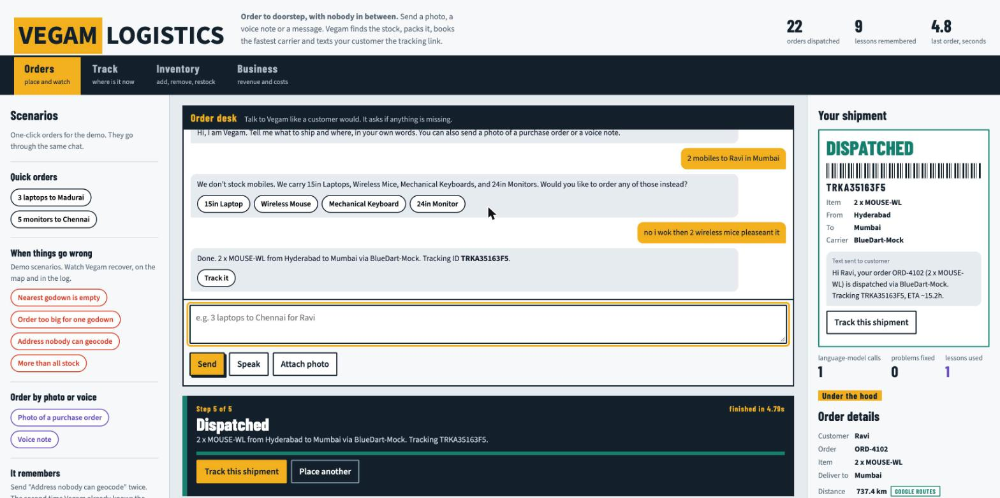
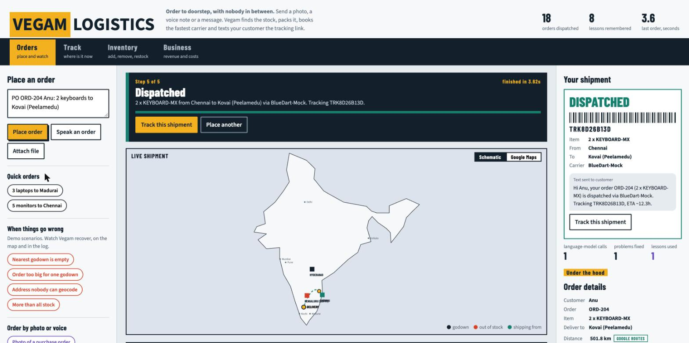
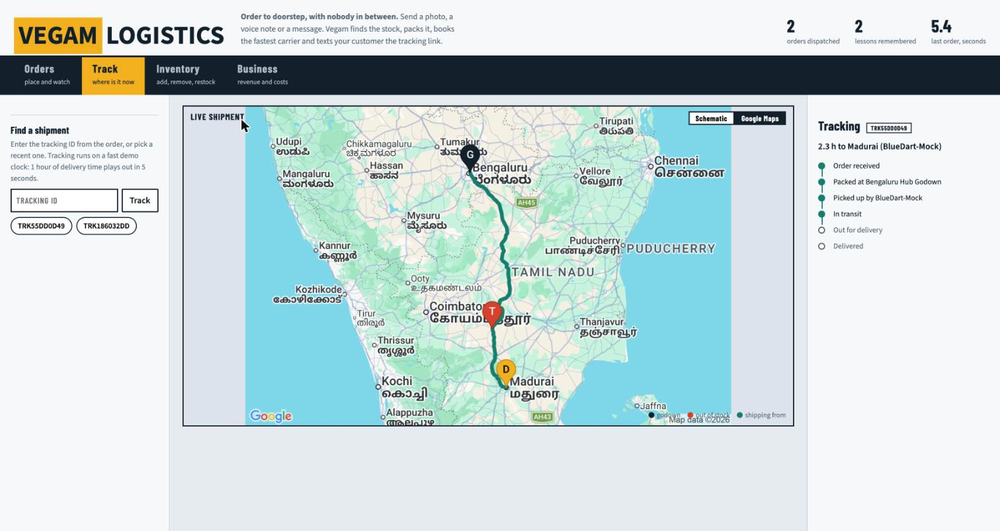
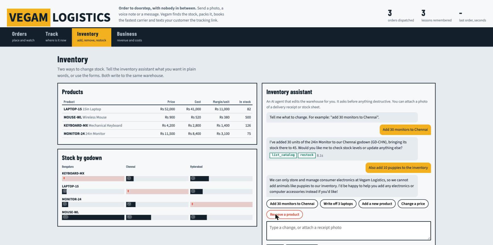

# Vegam Logistics: autonomous order-to-doorstep agents

**Live demo: https://godown-agent-1090536656180.asia-south1.run.app**

Send an order as a **photo, a voice note or a chat message**. Vegam finds the stock across godowns, packs it, routes it on real roads, books the fastest carrier, dispatches it and texts the customer a tracking link, with nobody in between. If something is missing it asks, like a person would. A second agent manages inventory in plain language. Everything is automated end to end: godown, packaging, shipping, tracking and the business numbers.



*A real conversation: it says mobiles are not stocked, offers what it has, then ships the follow-up using the details from earlier in the chat.*



*Dispatched in 5.4 s: the real Google Maps road route from the godown to the customer, distance and drive time from the Routes API, the three carrier quotes compared, and the reserved stock.*



*Tracking: the truck moves along the actual road on the Google map while the timeline advances.*



*The inventory agent: "Add 30 monitors to Chennai" restocks the godown and the stock table updates, while "add puppies" is declined because Vegam handles consumer electronics only.*

## How this maps to the judging criteria

| Criterion | What we built | Where to see it |
|---|---|---|
| **MCP integration** | Our own MCP server (`mcp_server/warehouse_server.py`) with 14 tools: `check_stock`, `reserve_stock`, `select_box`, `get_route`, `get_carrier_quote`, `create_shipment`, `list_catalog`, `restock`, `add_item`, `update_item`, `remove_item`, `remove_stock`, `save_lesson`, `get_lessons`. The fulfilment engine uses an MCP client session and the inventory agent uses ADK's `McpToolset`. | The pipeline strip on the Orders view names the MCP tool behind each step |
| **Multimodal agents** | Orders arrive as a **photo** (purchase order, handwritten slip), a **voice note** (recorded in the browser or uploaded) or **text**; Gemini reads all three. Uploads are saved and linked to the shipment, and the inventory agent also reads receipt photos. | "Order by photo or voice" scenarios, **Speak** and **Attach photo** |
| **API calls** | Google **Geocoding** (full street addresses and `lat,lng`), **Routes** (real driving distance, time and road geometry), **Static Maps** (route image, through a server-side proxy so the key never reaches the browser), **Gemini**, **Jev (TypeSafe System One)**, and three carrier quote tools. | "GOOGLE ROUTES" badge in Order details; the Google Maps view |
| **Conversational, audio or automation** | All three. The order desk and the inventory assistant are chat agents with memory; voice orders are supported; the fulfilment itself is fully automated. | Orders and Inventory views |
| **Fastest end to end** | One LLM call on the happy path. After intake everything is deterministic code over MCP, with packaging and routing in parallel and all three carrier quotes in parallel. Typically **3 to 5 s** from message to tracking ID; the engine itself takes about 0.4 s. | The banner shows "finished in X s" |
| **A to Z, it works** | Chat, read order, stock, reserve, pack, route, carrier, dispatch, customer text, tracking with a moving truck, finance, inventory. 11 behaviour evals cover it. | Live URL, `eval_suite.py` |
| **Feedback loop, self-healing** | Failures are repaired automatically, every repair is saved as a lesson, and lessons are read back so the next run is faster and cheaper (see below). The demo has built-in controls to trigger each failure on demand. | "Problems Vegam solved on its own" log, "What Vegam has learned" panel |
| **Hosted, private repo** | Private GitHub repo, deployed to Google Cloud Run from the included `Dockerfile` and `deploy.sh`. | Link at the top |
| **Problem statement** | Godown to packaging to shipping, fully automated, with three godowns, box sizes, three carriers, stock, prices and customers, and Google APIs for locations. Business rules enforced in code: electronics only, India only. | Orders and Business views |

## Technical design

```
photo | voice | chat ──► Intake agent (Gemini, multimodal: the ONLY LLM step on the happy path)
                              │ validated order, or a natural question back to the customer
                              ▼
              Fulfilment engine (deterministic Python, talks to the MCP server)
   find stock ─► reserve ─► ( pack ‖ route ) ─► ( 3 carrier quotes ‖ ) ─► dispatch ─► audit
        │                                                                      │
        │ only when code-level recovery runs out                               ▼
        ▼                                                         tracking, finance, customer text
   Exception healer: Jev (TypeSafe System One) typed decisions, Gemini fallback

   Inventory agent (Gemini + MCP tools): add, restock, edit, write off, remove, from text or a receipt photo
```

**Agents only where reasoning is needed.** An early version used five LLM agents per order and took 30 s to 140 s. Moving stock lookup, packaging, routing and carrier choice into deterministic code brought it to 3 to 5 s with identical results. LLMs handle what code cannot: understanding free-form, untrusted human input (intake), deciding edge cases (healer) and turning free-form inventory requests into tool calls (inventory agent).

**Self-healing.**
- A carrier returns 503: retry, then exclude it from the choice.
- The nearest godown is empty: reroute to the next nearest with stock.
- An order is bigger than any one godown: split it across godowns.
- An address will not geocode: Google Geocoding, then coordinates, then the customer is asked for a city or pincode (offline mode uses the Jev healer).
- More than total stock: ship what exists and back-order the rest.
- A step fails after stock was reserved: the reservation is released, so failures never leak inventory.
- A tool crashes or returns garbage: surfaced as an error the engine retries, never a crash.
- Missing or non-order messages: the agent asks only for what is missing and continues the same conversation.

**Learning loop.** Every repair is written to `lessons.json` and read back before the next run. A learned address alias skips the healer call entirely, and a carrier that failed before gets hedged requests (two in parallel) instead of a sequential retry. The `learns-across-runs` eval proves the second run uses fewer LLM calls than the first.

**Failure injection built in.** The Orders view has one-click scenarios for each failure (nearest godown empty, order too big for one godown, address nobody can geocode, more than all stock) and a switch that takes the FastFreight carrier down on its first request. The Reset button restores the seed data.

**Jev as the fast decision model.** The healer asks Jev typed Choice questions (which city, which action, is it in India) and reads the confidence score. A low-confidence answer, an error or a missing key falls back to Gemini.

**Business rules enforced in code, not only in prompts.**
- **India only.** Every destination is geocoded and the country Google resolves it to must be India. Coordinates are reverse-geocoded. Paris, London, Colombo, "Delhi Hotel, Dubai" and `40.7128, -74.0060` are all refused with the reason, and shipment creation checks again. Addresses Google cannot place are never guessed: the customer is asked.
- **Electronics only.** Inside the warehouse tools: unicode-normalised deny list, allow list, then a Jev classification that fails closed. "Add rats", "add puppies" and "rename the mouse to rats" are refused, whichever agent or form asks.
- **People decide destructive actions.** The inventory agent can only queue a deletion or a stock removal; a person clicks Confirm. Text inside a photo cannot authorise anything.

**Safety.** The intake model has no tools and its JSON is re-validated (positive whole quantities, bounded sizes, markup stripped); tool arguments are validated again server-side; inventory edits and reset need an admin token on the public URL; per-client and global rate limits protect LLM and Maps cost; uploads are checked for size, type and magic bytes; security headers are set; the map proxy validates its input; public responses hide customer names and addresses.

## The 11 evals

`eval_suite.py` runs every case in parallel against its own temporary database and lessons file, so cases cannot affect each other. It pins the offline geocoder so address-healing paths are exercised the same way every time. Each case checks the outcome (status, godown, product, destination, whether anything was healed) and reports seconds and LLM calls. **Result: 11/11 pass, about 3 to 5 s per case, 4 s wall for the whole suite when run in parallel.**

| # | Case | Order sent | What it proves | Pass criteria |
|---|---|---|---|---|
| 1 | `happy-path` | "3 laptops to Madurai" | The full A-to-Z flow works with one LLM call | Dispatched, shipped from Bengaluru (nearest with stock) |
| 2 | `nearest-has-stock` | "5 monitors to Chennai" | No false repairs: nothing is healed when nothing is wrong | Dispatched from Chennai, no repair recorded |
| 3 | `reroute-oos` | "3 laptops to Chennai" | Self-healing when the nearest godown (Chennai, 0 laptops) is empty | Dispatched from Bengaluru, reroute recorded |
| 4 | `split-order` | "70 laptops to Hyderabad" | One order split across godowns when no single godown has enough | Dispatched in full (60 from Hyderabad plus 10 from Bengaluru), split recorded |
| 5 | `shortfall` | "500 laptops to Pune" | Graceful partial fulfilment when demand exceeds all stock | Partial shipment of the 85 units that exist, the remaining 415 back-ordered, healer decision recorded |
| 6 | `bad-address` | "2 keyboards to Kovai (Peelamedu)" | Address repair through the Jev healer | Dispatched with the destination normalised to Coimbatore |
| 7 | `fuzzy-product` | "4 notebook computers to Mumbai" | Natural product names map to catalogue items | Dispatched as LAPTOP-15 |
| 8 | `flaky-carrier` | "10 wireless mice to Bengaluru" with FastFreight failing | Retry and fallback when a carrier API returns 503 | Dispatched, carrier retry recorded |
| 9 | `voice-order` | Audio file: "two mechanical keyboards to Kochi, order 4419" | The multimodal voice path, from speech to shipment | Dispatched as KEYBOARD-MX to Kochi |
| 10 | `image-order` | Photo of a printed purchase order | The multimodal image path, from a photo to shipment | Dispatched as LAPTOP-15 to Madurai |
| 11 | `learns-across-runs` | The bad-address order, twice, sharing one lessons file | The learning loop: lessons written in run 1 are applied in run 2 | Run 1 makes 2 LLM calls; run 2 makes 1 and records an applied lesson |

Together the evals cover every branch of the flow: normal, rerouted, split, partial, repaired address, natural-language product, two modalities, a flaky external API, and learning.

### Adversarial tests

`security_suite.py` attacks a running server with 35 checks: admin gating, negative and absurd quantities, markup in names and SKUs, oversized and disguised uploads, path traversal, rate limiting, security headers, hostile and prompt-injection orders, markup in addresses, incomplete orders that must ask and then continue, and an inventory agent that must never delete without a human click. It passed 35 of 35 on its last full run.

## Run it locally

```
python -m venv .venv && .venv/bin/pip install -r requirements.txt
cp my_agent/.env.example my_agent/.env     # GOOGLE_API_KEY, JEV_API_KEY, GOOGLE_MAPS_API_KEY, USE_REAL_MAPS=1
.venv/bin/uvicorn dashboard:app --port 8020   # open http://localhost:8020
.venv/bin/python eval_suite.py                # the 11 evals
```
Deploy: `ADMIN_TOKEN=<secret> ./deploy.sh <gcp-project-id>`

## Dashboard

- **Orders:** the chat order desk, Google Maps by default (a schematic view is one click away), a live step banner ("Step 2 of 5: Finding stock"), the pipeline with the MCP tool behind each step, and the problems Vegam solved on its own.
- **Track:** tracking-ID lookup, a status timeline, a truck moving along the real road (demo clock: 1 hour of ETA plays out in 5 s), and the original order photo or voice note.
- **Inventory:** product table, stock bars by godown, the inventory assistant chat, manual forms, and a panel of actions waiting for your confirmation.
- **Business:** orders, units, revenue, product cost, shipping and packaging cost, profit and margin, and units sold per product.
